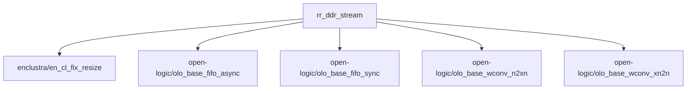
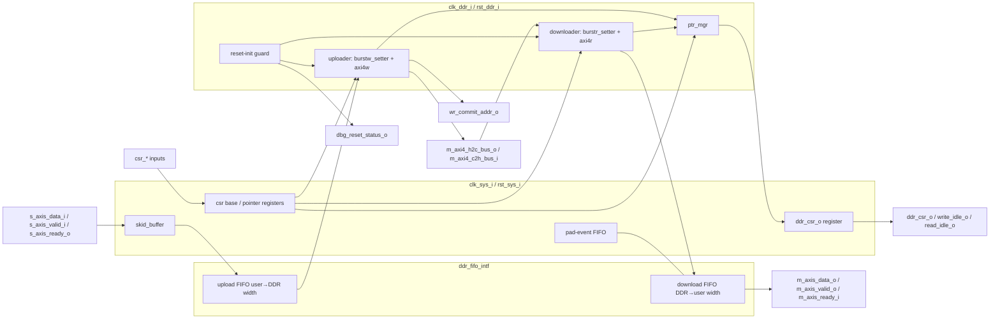

<!-- rr:fdd v1 ip=rr_ddr_stream -->
# rr_ddr_stream — Firmware Design Document

Facts verified against `256631b` on 2026-10-20.

<!-- rr:fdd:generated:begin -->
<!-- rr:fdd:inputs sha256:272c5f0abf8535b5 -->
<!-- rr:fdd:projection v3 -->
> Machine-owned block — scaffolded by `rr fdd init`, refreshed by
> `rr fdd generate`. Do not edit inside the markers;
> edit the canonical declarative files it references. FDD state is
> documentation completeness only — never behavioral proof.

**IP:** `rr_ddr_stream` v0.2

## Canonical References

- **Requirements** — `requirements.yml`: DDR-REQ-001 (behavioral), DDR-REQ-002 (behavioral), DDR-REQ-200 (behavioral), DDR-REQ-203 (negative), DDR-REQ-205 (behavioral), DDR-REQ-204 (negative), DDR-REQ-206 (negative), DDR-REQ-207 (behavioral), … (+19 more — see the Requirements table below)
- **Interfaces** — `requirements.yml` port_contract:
  - `M_AXI` — axi4 master
  - clocks: `CLK_SYS`, `CLK_DDR`
  - resets: `RST_SYS`, `RST_DDR`
  - 16 scalar port(s)
  - parameters: `G_AXI_ID`=0, `G_FIFO_DEPTH`=9, `G_USER_DATA_WIDTH`=32, `G_DDR_DATA_WIDTH`=128, `G_DDR_ADDR_WIDTH`=32, `G_DDR_BASE_ADDR`=0, `G_BUFFER_WIDTH`=31, `G_ENABLE_WRITE_PLANE`=True, `G_ENABLE_READ_PLANE`=True
  - _contract_: declared here from the contract — not proof the HDL matches; verify with `rr sim contract-check`
- **Registers** — none declared
- **Dependencies** — `ip.yml` build.ips: `enclustra/en_cl_fix_resize`, `open-logic/olo_base_fifo_async`, `open-logic/olo_base_fifo_sync`, `open-logic/olo_base_wconv_n2xn`, `open-logic/olo_base_wconv_xn2n`
- **Decisions** — no `decisions.yml`

## Requirements

| ID | Kind | Requirement |
|---|---|---|
| DDR-REQ-001 | behavioral | End-to-end round-trip: N consecutive `S_AXIS_DATA` values accepted on `CLK_SYS` (`S_AXIS_VALID`=1 & `S_AXIS_READY`=1), after the IP commits them to DDR, are returned on `M_AXIS_DATA` (`M_AXIS_VALID`=1) in the same FIFO order regardless of the AXI4 memory model's burst shape or latency. This subsumes "no lost / no duplicate message". |
| DDR-REQ-002 | behavioral | When the DRAM ring (2^`G_BUFFER_WIDTH` bytes) fills, the IP applies back-pressure (`S_AXIS_READY` deasserts) and further ingress does NOT corrupt previously-committed ring state. Writes resume cleanly once space is freed (a consumer advances the read side). |
| DDR-REQ-200 | behavioral | Every write burst drives `M_AXI_AWADDR` equal to the current write-head DRAM address inside the configured ring and `M_AXI_AWSIZE` encoding `G_DDR_DATA_WIDTH`/8 bytes per beat. |
| DDR-REQ-203 | negative | No write burst on M_AXI crosses a 4 KiB boundary: (`M_AXI_AWADDR` mod 4096) + (`M_AXI_AWLEN`+1)*(1<<`M_AXI_AWSIZE`) ≤ 4096 (AMBA AXI4 §A3.4.1). |
| DDR-REQ-205 | behavioral | INPUT DOMAIN — STATIC BASE ADDRESS. `G_DDR_BASE_ADDR` accepts every unsigned 32-bit value, including the upper half 0x80000000..0xffffffff, and both the AXI and AVMM top-level wrappers elaborate with that value. The generic must not be constrained by the implementation-defined VHDL INTEGER range; a 32-bit-INTEGER tool therefore accepts 0x80000000 as a `G_DDR_BASE_ADDR` even though it rejects that value as an INTEGER. |
| DDR-REQ-204 | negative | With `G_MAX_BURST_LEN`=16 (the AXI3 / Zynq-7 S_AXI_HP target) no write burst on M_AXI exceeds 16 beats: every accepted `M_AXI_AWLEN` ≤ 15. At the AXI4 default (`G_MAX_BURST_LEN`=256) the ring DOES emit `M_AXI_AWLEN`>15 under DDR-cadence back-pressure — that >16-beat region is AXI3-illegal and is exactly what the clamp removes (VFIFO-T2.6 / IDP-T2.5). |
| DDR-REQ-206 | negative | POLARFIRE SOC FIC BURST CAP CONFORMANCE (DDR-P2.15). On the Microchip backend (`ddr_stream_fic` / `wrapper_ddr_stream_fic`), no write burst on M_AXI exceeds 64 beats (`C_PFSOC_FIC_MAX_BURST`): every accepted `M_AXI_AWLEN` ≤ 63. Under DDR-cadence back-pressure, bursts remain capped to at most 64 beats even when `G_MAX_BURST_LEN` defaults to or is set to 256, honours the `C_PFSOC_FIC_MAX_BURST` constant, and prevents AXI3-class illegal burst lengths from reaching the PolarFire SoC FIC target port. |
| DDR-REQ-207 | behavioral | CORE-SIDE CONTRACT INSTRUMENTATION (DS-T1.13 / DDR-P2.15). The Microchip PolarFire SoC backend exposes the identical core-side contract as the AXI master: write-plane arming deasserts `DDR_CSR` `chip_empty` upon ingress; `WR_COMMIT_ADDR` advances and wraps on ring boundary; `WRITE_IDLE` and `READ_IDLE` signal active status; `VERSION` stamps the IP version; `DBG_RESET_STATUS` reports active chip-select status; and `DDR_CSR` telemetry counters (`fifoCnt`, `fifoFullCnt`, `fifoEmptyCnt`) track ring occupancy and backpressure. |
| DDR-REQ-208 | behavioral | PRODUCT GEOMETRY WRITE PATH (DS-T1.12 / DDR-P2.14). With write plane enabled and read plane disabled (`G_ENABLE_READ_PLANE`=false), DDR base `G_DDR_BASE_ADDR` in the upper 32-bit address space (≥ 0x8000_0000, specifically 0xA0000000), 256-bit DDR data width (`G_DDR_DATA_WIDTH`=256), burst cap `G_MAX_BURST_LEN`=16, and ring buffer window `G_BUFFER_WIDTH`=28, ingress traffic accepted on `S_AXIS_DATA` (`S_AXIS_VALID`=1 and `S_AXIS_READY`=1) with sniffer cadence (including short bursts, 1-word frames, and 0-word FIFO empty edges) causes the uploader to issue write bursts on `M_AXI` (`M_AXI_AWVALID` asserts with `M_AXI_AWADDR` within [base, base+2^`G_BUFFER_WIDTH`)), `WRITE_IDLE` deasserts during active write operations, and the commit pointer `WR_COMMIT_ADDR` advances past 0 upon write completion. |
| DDR-REQ-210 | behavioral | The write pointer is a RING: `M_AXI_AWADDR` wraps from the top of the ring window back to the base and never escapes [base, base+2^`G_BUFFER_WIDTH`), sustaining writes across many wraps when the read side keeps freeing space. |
| DDR-REQ-211 | negative | BASE-ADDRESS LOAD IS QUASI-STATIC (DDR-P2.29). A `CSR_WR_BASE_LOAD` pulse sampled while `WRITE_IDLE`=0, or a `CSR_RD_BASE_LOAD` pulse sampled while `READ_IDLE`=0, MUST NOT change the base: the in-flight buffer completes at its old base with no `M_AXI_AWADDR` / `M_AXI_ARADDR` split across two bases, and the host retries once both idle flags are high. INPUT DOMAIN: the host loads `CSR_WR_BASE_ADDR` / `CSR_RD_BASE_ADDR` only while that plane holds no data (after reset, or after the ring drained) and does not feed it until the load has settled (32 `CLK_DDR` cycles). The base reaches `CLK_DDR` through a per-bit two-flop capture with no handshake, so this protocol is what keeps the multi-bit crossing from being sampled torn. The four captures carry `-- rr-lint-disable-line RR-CDC-005` naming this REQ. |
| DDR-REQ-400 | negative | With `G_ENABLE_READ_PLANE`=false, `M_AXI_ARVALID` never asserts and `M_AXIS_VALID` stays low / `READ_IDLE` stays high for the whole run, regardless of `M_AXIS_READY` or write activity. |
| DDR-REQ-401 | negative | With `G_ENABLE_WRITE_PLANE`=false, `M_AXI_AWVALID` / `M_AXI_WVALID` never assert and `S_AXIS_READY` stays low / `WRITE_IDLE` stays high, regardless of how `S_AXIS_VALID` is driven. |
| DDR-REQ-500 | behavioral | With `G_ENABLE_READ_PLANE`=false (no HW downloader), a consumer that drains DDR via its own master re-instates the SPSC drain by writing the byte offset it has consumed up to (mod ring size) on `CSR_RD_PTR_ADDR` with `CSR_RD_PTR_LOAD`=1. The IP frees the corresponding ring space so the write pointer (`M_AXI_AWADDR`) keeps wrapping — sustained, lossless operation past many rings. Same units as the commit pointer (`wr_commit_addr_o`). The load is gated by the read bus being idle (always, with the read plane elided), so it may be advanced at any time. |
| DDR-REQ-501 | behavioral | Back-compatibility / opt-in: with `G_ENABLE_READ_PLANE`=false and the software read pointer NEVER written (`CSR_RD_PTR_LOAD`=0), behaviour is byte-identical to the legacy tied-low read pointer — the ring fills to the top exactly once and then stalls (`M_AXI_AWADDR` reaches the last slot and does not wrap again). `CSR_RD_PTR_ADDR` defaults to 0. |
| DDR-REQ-502 | behavioral | With `G_ENABLE_WRITE_PLANE`=false (no HW uploader), a producer that fills DDR via its own master re-instates the SPSC source by writing the byte offset it has produced up to (mod ring size) on `CSR_WR_PTR_ADDR` with `CSR_WR_PTR_LOAD`=1. The IP presents the corresponding ring data so the HW downloader's read pointer (`M_AXI_ARADDR`) keeps wrapping — sustained, lossless reads past many rings. Same units as the commit pointer (`wr_commit_addr_o`). |
| DDR-REQ-503 | behavioral | Back-compatibility / opt-in: with `G_ENABLE_WRITE_PLANE`=false and the software write pointer NEVER written (`CSR_WR_PTR_LOAD`=0), behaviour is byte-identical to the legacy tied-to-`uploader_addr` (=0) write pointer — the ring is permanently empty and the downloader issues NO read bursts (`M_AXI_ARVALID` never asserts). `CSR_WR_PTR_ADDR` defaults to 0. |
| DDR-REQ-600 | behavioral | N-BUFFER ROTATION. With the ring window carved into N equal FRAME_BYTES slots (ring = N*FRAME_BYTES) and a conforming producer delivering exactly FRAME_BYTES per frame, the write head `M_AXI_AWADDR` starts at the pool base (SOF-aligned: the first accepted write of a run lands at slot 0) and then sweeps the N frame-buffer slots in strict ascending round-robin — slot k, k+1, … N-1, 0 — never skipping a slot, sustained across many ring passes as the read side frees space. Robust to source bubbles (`S_AXIS_VALID` deasserting) at frame starts: a stalled-but-complete frame does not perturb the rotation. |
| DDR-REQ-601 | behavioral | FRAME-GRANULAR TEAR-FREE DRAIN. A consumer that advances `CSR_RD_PTR_ADDR` only in whole-FRAME_BYTES increments — never mid-frame — sustains lossless ring rotation exactly as a byte-granular drain does: the write head `M_AXI_AWADDR` keeps wrapping within the N-buffer pool and never escapes it and never wedges. Because the reader releases only WHOLE frames, the ring's SPSC no-overwrite invariant (DDR-REQ-001/002/500) is applied at frame granularity — the writer's back-pressure lands on a frame boundary, so the frame most-recently released to the reader is complete, never a torn splice of two producer passes. Precondition (see DDR-REQ-603): the AXI write-burst cap `G_MAX_BURST_LEN` must be ≤ FRAME_BYTES/beat, else one burst can span a whole frame and back-pressure cannot land on a frame boundary. |
| DDR-REQ-602 | negative | INPUT-DOMAIN — EXACT FRAME CADENCE. The IP is frame-agnostic: it commits `S_AXIS_DATA` words to the ring in strict byte order with no notion of frame length and no SOF/restart port. A producer therefore MUST deliver EXACTLY FRAME_BYTES per frame. A RUNT frame (fewer than FRAME_BYTES) — or, equivalently, a mid-frame SOF that restarts a buffer before it is full — is OUTSIDE the input domain: the IP does not pad or re-align it, so it shifts every subsequent frame base by the byte deficit and desynchronises the N-buffer rotation. This is distinct from back-pressure/bubbles: a frame that is merely stalled (`S_AXIS_VALID`=0 gaps) but eventually complete is IN-domain and does not desync. The test proves the constraint is load-bearing by driving one runt frame and observing the frame markers in DDR land at non-FRAME_BYTES-aligned addresses. |
| DDR-REQ-603 | negative | INPUT-DOMAIN — WHOLE-BUFFER GEOMETRY, NO PER-BURST ATOMICITY. The frame -buffer contract (600–602) holds only when FRAME_BYTES divides the ring 2^`G_BUFFER_WIDTH` (an integral number N of whole slots). A FRAME_BYTES that does not divide the ring is prohibited: a frame then straddles the ring wrap and occupies two non-adjacent regions. Separately, consumers MUST NOT assume per-burst buffer atomicity — because the IP is a linear byte ring, a single `M_AXI_AWADDR` write burst MAY straddle a FRAME_BYTES slot boundary; frame integrity is a property of the byte SEQUENCE (600/601), not of AXI burst boundaries. The test proves both: with a dividing geometry the write head crosses each FRAME_BYTES boundary at an aligned address, and it exhibits at least one burst that straddles a slot boundary — the exact limitation a consumer must design around. |
| DDR-REQ-RST-1 | negative | While `RST_SYS` / `RST_DDR` are asserted, and throughout the reset-busy settling window after deassertion, the IP issues no master traffic: `M_AXI_ARVALID`, `M_AXI_AWVALID`, and `M_AXIS_VALID` all stay low. |
| DDR-REQ-RST-2 | behavioral | After reset deassertion and a CDC settle window, the ring reports empty across the clock-domain crossing (chip-empty), so no read is issued on an unwritten ring — `M_AXI_ARVALID` never asserts. |
| DDR-REQ-RST-3 | behavioral | After a reset applied mid-stream (during active read traffic) and then deasserted, the IP recovers and resumes issuing read transactions (`M_AXI_ARADDR`); with the write plane disabled, `M_AXI_AWVALID` stays low throughout. |
| DDR-REQ-RST-4 | negative | Under asymmetric reset deassertion (`RST_SYS` released before `RST_DDR`), no read traffic is issued during the reset-busy window: `M_AXI_ARVALID` stays low until both domains are out of reset and settled — the cross-domain reset deassertion is safe. |
| DDR-REQ-RST-5 | negative | A reset applied mid-stream, after the software-managed ring pointer has been driven to a non-zero, wrapped position, fully clears the internal pointer state: no `M_AXI_ARVALID` / `M_AXIS_VALID` during the reset-busy window, and — with no new pointer CSR pulse after reset — the ring behaves exactly like a cold, never-written ring (empty, no reads). The pointer registers must never carry stale pre-reset position across the reset boundary (DDR-T2.15 coverage gap, DDR-P2.9). |
| DDR-REQ-RST-6 | negative | A runtime `RST_SYS` pulse after init, with `RST_DDR` held low, re-enters the endpoint FIFO reset-busy window (`pipeBusyDdr` high). On every `CLK_DDR` cycle of that window both `uploader_cs` and `downloader_cs` stay low, including the first cycle `pipeBusyDdr` rises. After `pipeBusyDdr` falls, both stay low for the full reset-init timeout before either is released again. |

## Register Map

none declared

## Block Diagram

## Decision Index

none declared
<!-- rr:fdd:generated:end -->

## Overview

- `rr_ddr_stream` is a stream-to-DDR ring-buffer DMA engine.
- Ingress: an AXI-Stream-style port (`s_axis_*`) in the `clk_sys_i` domain.
- Egress: an AXI-Stream-style port (`m_axis_*`) in the `clk_sys_i` domain.
- Storage: a ring of 2^`buffer_width_g` bytes in external memory, starting at a base address.
- Memory access: a bus master in the `clk_ddr_i` domain.
- Data order is preserved end to end (DDR-REQ-001).
- Ingress is back-pressured when the ring is full (DDR-REQ-002).
- The IP has no register bank. Status leaves on the `ddr_csr_o` record and flat status ports. Control enters on flat `csr_*` ports. The integrating design maps them into its own register space (`docs/CSR_CONTRACT.md`).

### Top-level entities

One package, three top-level entities (`ip.yml` `hdl.tops`):

| Entity | File | Memory bus | Target memory |
|---|---|---|---|
| `ddr_stream_axi` | `rtl/ddr_stream_axi.vhd` | AXI4 master (`m_axi4_h2c_bus_o` / `m_axi4_c2h_bus_i`) | AXI4 memory controllers |
| `ddr_stream_avmm` | `rtl/ddr_stream_avmm.vhd` | Avalon-MM host (`m_avmm_h2c_bus_o` / `m_avmm_c2h_bus_i`) | Avalon-MM memory controllers (EMIF) |
| `ddr_stream_fic` | `rtl/ddr_stream_fic.vhd` | AXI4 master; instantiates `ddr_stream_axi` | PolarFire SoC fabric interface controller (FIC) target port |

`ip.yml` `hdl.top_module` (the standalone build default) is `ddr_stream_axi`.

### Port surface per top-level entity

| Port group | `ddr_stream_axi` | `ddr_stream_fic` | `ddr_stream_avmm` |
|---|---|---|---|
| `clk_sys_i`, `clk_ddr_i`, `rst_sys_i`, `rst_ddr_i` | yes | yes | yes |
| `s_axis_data_i` / `s_axis_valid_i` / `s_axis_ready_o` | yes | yes | yes |
| `m_axis_data_o` / `m_axis_valid_o` / `m_axis_ready_i` | yes | yes | yes |
| `csr_wr_base_addr_i` / `csr_wr_base_load_i`, `csr_rd_base_addr_i` / `csr_rd_base_load_i` | yes | yes | yes |
| `csr_wr_ptr_reset_i`, `csr_rd_ptr_reset_i` | yes | yes | yes |
| `csr_rd_ptr_addr_i` / `csr_rd_ptr_load_i`, `csr_wr_ptr_addr_i` / `csr_wr_ptr_load_i` | yes | yes | no |
| `write_idle_o`, `read_idle_o`, `ddr_csr_o` | yes | yes | yes |
| `version_o`, `wr_commit_addr_o`, `dbg_reset_status_o` | yes | yes | no |

All `csr_*` inputs have default values (`'0'` / all zeros), so they can be left unconnected.

## Theory of Operation

### Data path

| Stage | Block | Clock | Function |
|---|---|---|---|
| 1 | `skid_buffer` (`i_skid_in`) | `clk_sys_i` | 2-deep registered skid buffer on `s_axis_*`. `s_axis_ready_o` is registered. |
| 2 | `ddr_fifo_intf` upload FIFO (`rr_fifo_async_mixed`) | `clk_sys_i` → `clk_ddr_i` | Packs `user_data_width_g` words into `ddr_data_width_g` words and crosses into `clk_ddr_i`. |
| 3 | `uploader` (`burstw_setter` + `axi4w`), or `uploader_avmm` (`burstw_setter` + `avmm_w`) | `clk_ddr_i` | Sizes each write burst and drives the memory bus write channel. |
| 4 | External memory ring | — | 2^`buffer_width_g` bytes from the write or read base address. |
| 5 | `downloader` (`burstr_setter` + `axi4r`), or `downloader_avmm` (`burstr_setter` + `avmm_r`) | `clk_ddr_i` | Sizes each read burst and drives the memory bus read channel. |
| 6 | `ddr_fifo_intf` download FIFO (`rr_fifo_async_mixed`) | `clk_ddr_i` → `clk_sys_i` | Unpacks `ddr_data_width_g` words into `user_data_width_g` words and crosses into `clk_sys_i`. |
| 7 | Egress (`ddr_stream_axi`) | `clk_sys_i` | First-word-fall-through FIFO head, no skid buffer. `m_axis_valid_o` = FIFO not empty and not `rst_sys_i` (`rtl/ddr_stream_axi.vhd`, `g_read_plane`). |

### Ring pointers

- `ptr_mgr` runs in `clk_ddr_i`. Inputs: a write pointer and a read pointer, `buffer_width_g` bits each. Outputs: empty, full, almost-full, and the occupancy difference.
- Write pointer source: the uploader address when `enable_write_plane_g` = true, otherwise the software write pointer (`csr_wr_ptr_addr_i`).
- Read pointer source: the downloader address when `enable_read_plane_g` = true, otherwise the software read pointer (`csr_rd_ptr_addr_i`).
- Software pointers are byte offsets modulo 2^`buffer_width_g`, in the same units as `wr_commit_addr_o` (DDR-REQ-500, DDR-REQ-502).
- A software pointer that is never loaded stays 0. With the read plane removed, the ring then fills once and stalls (DDR-REQ-501). With the write plane removed, the ring stays empty and no read is issued (DDR-REQ-503).
- The write address wraps from the top of the ring to the base and stays inside [base, base + 2^`buffer_width_g`) (DDR-REQ-210).
- `ddr_csr_o.fifoStatus.chip_empty` is the `ptr_mgr` empty flag, synchronised into `clk_sys_i`. `chip_full` is the `ptr_mgr` almost-full flag, synchronised into `clk_sys_i`.

### Burst sizing

- `burstw_setter` / `burstr_setter` choose each burst length from the FIFO word count, the distance to the next 4 KiB boundary, the distance to the ring top, and `max_burst_len_g`.
- No write burst crosses a 4 KiB boundary (DDR-REQ-203).
- `max_burst_len_g` = 16 caps every write burst at 16 beats, for AXI3 slaves (DDR-REQ-204).
- `ddr_stream_fic` clamps `max_burst_len_g` to `C_PFSOC_FIC_MAX_BURST` (64 beats, `rtl/ddr_stream_pkg.vhd`). A larger value raises an elaboration warning (DDR-REQ-206).
- `M_AXI_AWSIZE` encodes `ddr_data_width_g`/8 bytes per beat (DDR-REQ-200).

### Write commit and bus errors

- `axi4w` publishes the write pointer only after a write response (BRESP) with OKAY.
- A non-OKAY BRESP withholds that burst: its data is never returned on `m_axis_*`. `ddr_csr_o.fifoStatus.write_error` is set.
- A non-OKAY RRESP returns the beats (zero data in the test model) and sets `ddr_csr_o.fifoStatus.read_error`.
- `write_error` and `read_error` are sticky until `rst_sys_i`.
- `wr_commit_addr_o` is the committed write address, in byte-offset units (DDR-REQ-207, DDR-REQ-208).
- Tests: `sim/cocotb/tests/test_demo_axi_error_response_conformance.py`, `sim/cocotb/tests/test_ddr_stream_axi.py`.

### Partial-word flush

- An upload word holds `ddr_data_width_g`/`user_data_width_g` user words.
- After 128 `clk_sys_i` cycles with no ingress write and a partly filled word (`C_IDLE_FLUSH_THRES`, `rtl/ddr_fifo_intf.vhd`), the IP completes the word with zero pad messages and sends it to memory.
- The pad messages are recorded in a pad-event FIFO (`i_pad_event_fifo`, `clk_sys_i`) and removed from `m_axis_*`.
- Test: `sim/cocotb/tests/test_demo_axi_partial_tail_conformance.py` (253 and 3 user words, every word returned in order).

### Base address

- Reset base: `ddr_base_addr_g`, a 32-bit vector. The full range 0x00000000..0xFFFFFFFF is legal (DDR-REQ-205).
- Run-time base: `csr_wr_base_addr_i` with a one-cycle `csr_wr_base_load_i` pulse; `csr_rd_base_addr_i` with `csr_rd_base_load_i`.
- A load pulse is accepted only while the plane idle flag (`write_idle_o` / `read_idle_o`) is high. A load while busy is dropped, not deferred (DDR-REQ-211).
- `csr_wr_ptr_reset_i` / `csr_rd_ptr_reset_i` rewind the plane pointer to offset 0 under the same idle rule. They are independent of the base load.

### Plane removal

- `enable_write_plane_g` = false removes the ingress skid buffer and the uploader. `s_axis_ready_o` = '0', `write_idle_o` = '1', no AW/W traffic (DDR-REQ-401).
- `enable_read_plane_g` = false removes the downloader. `m_axis_valid_o` = '0', `read_idle_o` = '1', no AR traffic (DDR-REQ-400).
- At least one plane must be enabled (elaboration assertion in `rtl/ddr_stream_axi.vhd`).
- Plane removal is available on `ddr_stream_axi` and `ddr_stream_fic` only.

### Frame-buffer use

- The IP has no notion of frames and no start-of-frame port (DDR-REQ-602).
- With the ring divided into N equal slots of FRAME_BYTES, and a producer delivering exactly FRAME_BYTES per frame, the write head visits the slots in ascending order (DDR-REQ-600).
- A consumer that releases the read pointer in whole-frame steps gets tear-free frames (DDR-REQ-601). Precondition: `max_burst_len_g` ≤ FRAME_BYTES per beat.
- FRAME_BYTES must divide 2^`buffer_width_g`. A single write burst can cross a slot boundary (DDR-REQ-603).

### Clocking and CDC

| Clock | Domain contents |
|---|---|
| `clk_sys_i` | `s_axis_*`, `m_axis_*`, `csr_*` inputs, `ddr_csr_o`, `write_idle_o`, `read_idle_o`, ingress skid buffer, pad-event FIFO |
| `clk_ddr_i` | memory bus, uploader, downloader, `ptr_mgr`, reset-init guard |

The two clocks are treated as asynchronous. Crossings:

| Crossing | Direction | Mechanism |
|---|---|---|
| Upload / download data | both | open-logic asynchronous FIFOs (gray-coded pointers, `olo_base_cc_bits`), reset crossing `olo_base_cc_reset` |
| Ring empty, ring almost-full, write-side bus busy (`write_idle_o`), write / read bus error | `clk_ddr_i` → `clk_sys_i` | `ddr_sync_cdc`, 2 stages (`C_CDC_NUM_STAGES` = 2) |
| Read-side bus busy (`read_idle_o`) | `clk_ddr_i` → `clk_sys_i` | `ddr_sync_cdc`, 8 stages (`C_CDC_NUM_STAGES` + `C_EXTEND_EMPTY_PIPE` = 2 + 6), `or_reduce_g` true: output is the OR of stages 2 to 7 |
| Endpoint FIFO reset-busy (`pipeBusy` → `pipeBusyDdr`), `ddr_stream_axi` and `ddr_stream_fic` only; `ddr_stream_avmm` leaves `pipeBusy` unused | `clk_sys_i` → `clk_ddr_i` | `ddr_sync_cdc`, 2 stages (`C_CDC_NUM_STAGES` = 2) |
| Upload FIFO empty, inside `ddr_fifo_intf` (`GEN_UPLOADER_BLOCK`, `i_sync_cdc_empty`) | `clk_ddr_i` (FIFO read clock) → `clk_sys_i` (`WR_CLK`) | `ddr_sync_cdc`, 3 stages (local `C_CDC_NUM_STAGES` = 3 in `rtl/ddr_fifo_intf.vhd`). The download FIFO empty has no crossing; it is used in its own read domain |
| Software read / write pointer | `clk_sys_i` → `clk_ddr_i` | toggle synchronised by `ddr_sync_cdc` enables the capture of the held multi-bit value |
| Run-time base address | `clk_sys_i` → `clk_ddr_i` | per-bit 2-flop capture, no handshake. Quasi-static: the source changes only on an accepted idle load (DDR-REQ-211) |
| Pointer reset pulses | `clk_sys_i` → `clk_ddr_i` | toggle through `ddr_sync_cdc` |

Shipped scoped constraints (`ip.yml` `build.sources`):

| File | Tool | Content |
|---|---|---|
| `constraints/ddr_stream_cdc_scoped.xdc` | Vivado, applied with `read_xdc -ref ddr_stream_axi` | `set_max_delay -datapath_only 8.000` to every crossing destination register; false path on the olo reset-crossing preset/clear pins |
| `constraints/ddr_stream_cdc_scoped.sdc` | Quartus | the same crossings in Quartus SDC (`set_false_path`, `set_net_delay -max`, `set_max_skew`) |
| `constraints/ddr_stream_cdc_scoped_microchip.sdc` | Libero SmartTime | the same crossings; not listed in `build.sources.sdc` |

`tests/test_cdc_xdc_drift.py` checks that every selector in the three files matches a register in the IP sources.

### Reset

- `rst_sys_i` resets the `clk_sys_i` domain; `rst_ddr_i` resets the `clk_ddr_i` domain. Both are active high.
- In the IP processes both are sampled on the rising edge of their own clock.
- `ddr_csr_o` returns to `C_INIT_FIFO_CSR` on `rst_sys_i` (empty = '1', chip_empty = '1').
- Reset-init guard (`clk_ddr_i`), `ddr_stream_avmm`: the uploader and downloader chip selects rise after 64 `clk_ddr_i` cycles (`C_RESET_INIT_TIMEOUT`). `rst_ddr_i` lowers both chip selects and restarts the count. `rst_sys_i` alone does not lower them. `pipeBusy` is assigned and not read.
- Reset-init guard (`clk_ddr_i`), `ddr_stream_axi` and `ddr_stream_fic`: the chip selects rise after 64 `clk_ddr_i` cycles and when the endpoint FIFO reset-busy flag (`pipeBusyDdr`) is low.
- `ddr_stream_axi` and `ddr_stream_fic`: any reset-busy period, including one caused by `rst_sys_i` alone, lowers both chip selects and restarts the 64-cycle count (DDR-REQ-RST-6). Simulated on `wrapper_ddr_stream_axi` only (`test_ddr_t2_17_runtime_cs.py`).
- No master traffic during reset and during the reset-busy window (DDR-REQ-RST-1). Asymmetric deassertion is covered by DDR-REQ-RST-4.
- `dbg_reset_status_o`: bit 0 downloader chip select, bit 1 uploader chip select, bit 2 `pipeBusyDdr`, bit 3 `pipeBusy`. Raw taps from both domains, not synchronised.

## Architecture

### Block diagram (`ddr_stream_axi`)

`ddr_stream_avmm` has the same structure with `uploader_avmm` (`avmm_w`) and `downloader_avmm` (`avmm_r`) on one shared Avalon-MM host port. `ddr_stream_fic` is a wrapper around `ddr_stream_axi`.

### Source units

| Unit | File | Role |
|---|---|---|
| `ddr_stream_pkg` | `rtl/ddr_stream_pkg.vhd` | bus records, `fifo_csr_t`, version constant, FIC constants |
| `ddr_fifo_intf` | `rtl/ddr_fifo_intf.vhd` | upload / download clock-crossing FIFOs, partial-word flush, pad stripping |
| `uploader`, `downloader` | `rtl/uploader.vhd`, `rtl/downloader.vhd` | AXI4 write / read planes |
| `uploader_avmm`, `downloader_avmm` | `rtl/avmm/` | Avalon-MM write / read planes |
| `burstw_setter`, `burstr_setter` | `rtl/burstw_setter.vhd`, `rtl/burstr_setter.vhd` | burst length selection |
| `axi4w`, `axi4r` | `rtl/axi4w.vhd`, `rtl/axi4r.vhd` | AXI4 channel state machines |
| `avmm_w`, `avmm_r` | `rtl/avmm/avmm_w.vhd`, `rtl/avmm/avmm_r.vhd` | Avalon-MM state machines |
| `ptr_mgr` | `rtl/ptr_mgr.vhd` | ring empty / full / occupancy |
| `ddr_sync_cdc` | `rtl/support/ddr_sync_cdc.vhd` | multi-stage single-bit synchroniser |
| `skid_buffer` | `rtl/support/skid_buffer.vhd` | 2-deep skid buffer |
| `rr_fifo_sync`, `rr_fifo_async`, `rr_fifo_async_mixed` | `rtl/support/` | FIFO wrappers; `fifo_impl_g` selects open-logic (`"olo"`) or Xilinx XPM (`"xpm"`) |

Vendor-specific XPM bodies and their stubs are selected by `ip.yml` `synthesis.sources_per_vendor`.

### Configuration generics

The contract defaults are listed in the generated Interfaces section above. Generics outside the contract `parameters` list:

| Generic | Entities | Default (RTL) | Notes |
|---|---|---|---|
| `fifo_impl_g` | all three | `"olo"` | `"olo"` (open-logic, portable) or `"xpm"` (Xilinx XPM). |
| `max_burst_len_g` | `ddr_stream_axi`, `ddr_stream_fic` | 256 (`ddr_stream_axi`), `C_PFSOC_FIC_MAX_BURST` (`ddr_stream_fic`) | 16 for AXI3 slaves. |

Constraints on the generics:

- `ddr_data_width_g`/`user_data_width_g` must be a power of two ≥ 1 (`rtl/ddr_stream_axi.vhd` generic comment, `rtl/ddr_fifo_intf.vhd`).
- `enable_write_plane_g` or `enable_read_plane_g` must be true.
- `ddr_stream_fic` sets `ddr_data_width_g` to `C_FIC_DATA_WIDTH` (64) by default.
- `ddr_stream_avmm` has no `axi_id_g`, `enable_*_plane_g` or `max_burst_len_g`.
- The generic names in the RTL are lower case with a `_g` suffix (`buffer_width_g`). The contract and the flat simulation wrappers use upper case with a `G_` prefix (`G_BUFFER_WIDTH`).

### Register map reference

- The IP has no register bank (generated Register Map section: none declared).
- `ddr_csr_o` fields, the flat status / control signals and a reference consumer map: `docs/CSR_CONTRACT.md`.
- `version_o` = `C_DDR_STREAM_VERSION` = major (bits 31..24), minor (23..16), patch (15..8), 0x00 (7..0) (`rtl/ddr_stream_pkg.vhd`).

### Dependencies

Listed in the generated Canonical References section (`ip.yml` `build.ips`). The asynchronous FIFOs and width converters come from open-logic; `en_cl_fix_resize` comes from enclustra.

## Verification

### Contract simulation (cocotb, NVC)

| Area | Requirements | Test files (`sim/cocotb/tests/`) |
|---|---|---|
| Round trip, back-pressure, 4 KiB rule | DDR-REQ-001, 002, 203 | `test_ddr_stream_axi.py`, `test_ddr_stream_avmm.py`, `test_ddr_stream_avmm_drainrace.py`, `test_ddr_stream_avmm_reset_each.py`, `test_ddr_stream_fic.py` |
| Write address and size | DDR-REQ-200 | `test_ddr_wrap_repro.py` |
| AXI3 burst cap | DDR-REQ-204 | `test_ddr_stream_axi_axi3.py` |
| High base address | DDR-REQ-205 | `test_ddr_base_addr_high.py` |
| FIC burst cap, core-side outputs | DDR-REQ-206, 207 | `test_ddr_stream_fic.py` |
| Write-only product geometry | DDR-REQ-208 | `test_ddr_uploader_product_base.py` |
| Ring wrap | DDR-REQ-210 | `test_ddr_ring_escape.py` |
| Base load while busy | DDR-REQ-211 | `test_ddr_stream_axi.py` |
| Plane removal | DDR-REQ-400, 401 | `test_ddr_swptr_drain.py`, `test_ddr_swptr_fill.py`, `test_ddr_stream_axi_plane_elision.py` |
| Software pointers | DDR-REQ-500 to 503 | `test_ddr_swptr_drain.py`, `test_ddr_swptr_fill.py`, `test_ddr_ring_escape_read.py`, `test_ddr_swptr_drain_kv260_bounds.py` |
| Frame-buffer use | DDR-REQ-600 to 603 | `test_ddr_vdma_framebuf.py` |
| Reset | DDR-REQ-RST-1 to RST-6 | `test_ddr_reset_coverage.py`, `test_ddr_t2_17_runtime_cs.py`, `test_ddr_stream_fic.py` |

Additional simulation, not mapped to a contract requirement:

| Scope | Test files (`sim/cocotb/tests/`) |
|---|---|
| Burst setters | `test_burstw_setter.py`, `test_burstr_setter.py`, `test_burstw_setter_w256.py`, `test_burstr_setter_w256.py`, `test_burstw_setter_ptr_stage_t2_22.py`, `test_burstr_setter_ptr_stage_t2_22.py` |
| Pointer manager | `test_ptr_mgr.py` |
| Bus-protocol conformance (AXI4, Avalon-MM, AXI-Stream, error responses, partial tail, write back-pressure, reset recovery) | `test_demo_*_conformance.py` |
| Example designs | `test_ddr_validator_bist.py`, `test_ddr_validator_csr.py`, `test_lwh2f_csr_bridge.py`, `test_de25_lwh2f_nal.py`, `test_de25_nal_rom.py` |
| DDR timing model | `sim/models/tests/test_realistic_ddr_axi.py` |

### Static checks (pytest, `tests/`)

| Scope | Test files |
|---|---|
| CDC constraints | `test_cdc_xdc_drift.py`, `test_cdc_sdc_same_clock_cuts.py`, `test_cdc_sdc_plane_selectors_nowarn.py`, `test_ddr_sync_cdc_netlist.py`, `test_reset_request_crossing_bounded.py`, `test_single_plane_csr_cdc_8_6014.py`, `test_ddr_p2_29_base_addr_cdc_waiver.py`, `test_de25_cdc_packaging.py` |
| RTL behaviour and structure | `test_ddr_t2_17_runtime_cs.py`, `test_wr_commit_addr_follows_ptr_sel.py`, `test_ddr_p2_14_product_geometry.py` |
| Packaging and configuration | `test_ddr_p3_40_published_version_tagged.py`, `test_ddr_p3_44_delegated_to.py`, `test_ddr_p3_46_resolver_owned_sources.py`, `test_public_tree_clean.py`, `test_quartus_std_high_base.py`, `test_pfsoc_disco_ddr_validator_build.py`, `test_zybo_z7_20_regbank_consistency.py`, `test_bist_contract.py` |
| Hardware evidence records | `test_ddr_t1_3_silicon_gate.py`, `test_pfsoc_ddr_hw_witness.py`, `test_ddr_p2_21_gate_power.py` |
| This document | `test_ddr_p2_30_fdd.py` |

### Hardware evidence

| Board | Top | Result | Record |
|---|---|---|---|
| DE25-Standard (Agilex 5) | `ddr_stream_axi` | 16 of 16 cold boots: commit pointer advanced with the write pointer; both captures decoded from the ring. Verified against `55bb0af` and `1a4ff15` on 2026-10-02. | `docs/internal/DDR_T1_3_SILICON_GATE_WITNESS.md`, checked by `tests/test_ddr_t1_3_silicon_gate.py` |
| Zybo Z7-20 (xc7z020) | `ddr_stream_axi` | Routed timing with the scoped XDC, `clk_sys_i` 100 MHz / `clk_ddr_i` 125 MHz: WNS +0.021 ns, WHS +0.052 ns. | header of `constraints/ddr_stream_cdc_scoped.xdc` |

## Known Limitations

| Limitation | Tracking |
|---|---|
| `ddr_stream_avmm`: `write_error` / `read_error` are always 0, since Avalon-MM has no per-transfer error response. | `docs/CSR_CONTRACT.md` |
| `ddr_stream_avmm`: no plane removal, software pointers, `version_o`, `wr_commit_addr_o`, `dbg_reset_status_o` or `max_burst_len_g`. | — |
| `ddr_stream_fic`: no on-silicon DDR write / read witness. | DDR-P2.18 |
| No frame semantics: the producer must deliver exact, whole frames (DDR-REQ-602, 603). A frame-aware top-level entity is not implemented. | DDR-P2.13 |
| Run-time base address is a quasi-static crossing: a base load is safe only while the plane holds no data and before it is fed again (DDR-REQ-211). | — |
| `write_error` / `read_error` have no clear input; only `rst_sys_i` clears them. | `docs/CSR_CONTRACT.md` |
| `constraints/ddr_stream_cdc_scoped_microchip.sdc` is not packaged; a Microchip design copies it into its own project SDC sources. | `ip.yml` comment, `example/pfsoc_disco_ddr_validator` |
| The scoped XDC datapath bound is a fixed 8.000 ns, not derived from the clocks of the integrating design. | `constraints/ddr_stream_cdc_scoped.xdc` |

## Items to confirm

- DE25 timing of the `ddr_stream_avmm` same-domain path from `avmm_w` `ddr_addr_r` into the `ptr_mgr` ring-pointer compare (DDR-P3.12, setup miss). `rtl/burstr_setter.vhd` registers the ring-pointer distance before the burst clamp (DDR-T2.22, `sim/cocotb/tests/test_burstr_setter_ptr_stage_t2_22.py`). No slack figure and no timing result after that change are recorded in the tree.
- The generated header reports `rr_ddr_stream v0.2`. That is the `requirements.yml` `version` field. `ip.yml` `version` and `C_DDR_STREAM_VERSION` are 0.3.4.
- Required alignment of `ddr_base_addr_g` and of run-time base loads (DDR word, 4 KiB, or ring size). Not stated in the RTL or the contract.
- Whether `clk_sys_i` and `clk_ddr_i` may be the same clock. The `dbg_reset_status_o` comment names single-clock targets; no test was found that ties the two clocks together.
- With the read plane removed, the zero pad messages of a partial-word flush stay in memory and a software reader sees them. This follows from the RTL; no test was found that shows it.
- Whether the rest of the `ddr_csr_o` fields (`overflow`, `underflow`, `fifoFreeCnt`, `fifoFullCnt`, `fifoEmptyCnt`, `blockStrobeCnt`) are driven on every top-level entity. DDR-REQ-207 covers `fifoCnt`, `fifoFullCnt`, `fifoEmptyCnt` on `ddr_stream_fic` only.
- Hardware evidence for `ddr_stream_avmm` and for the Kria KV260, Zybo (classic) and AXE5-Eagle example designs. Not collected in this document.
